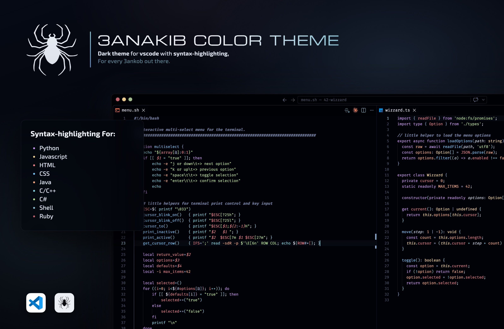
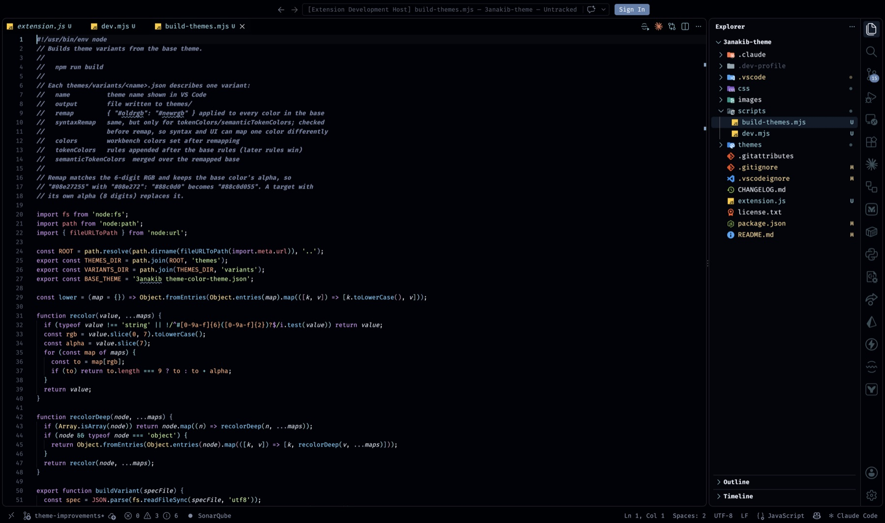
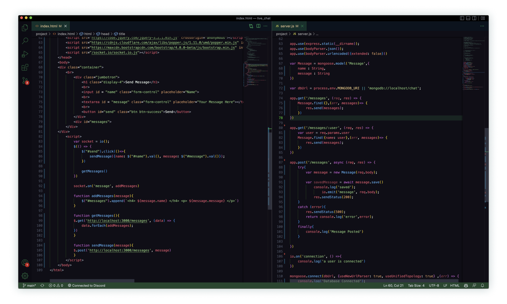
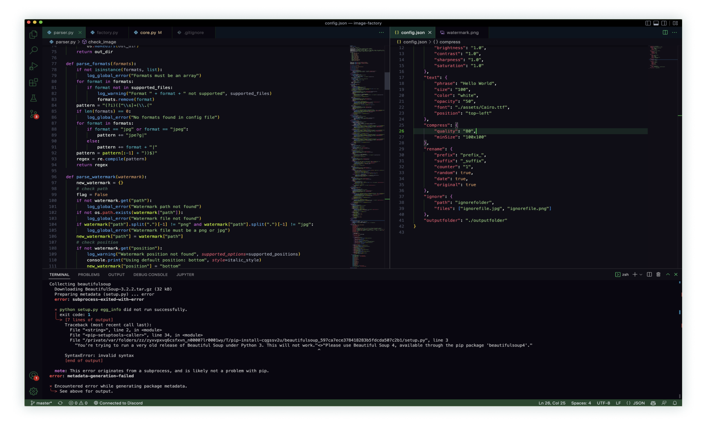
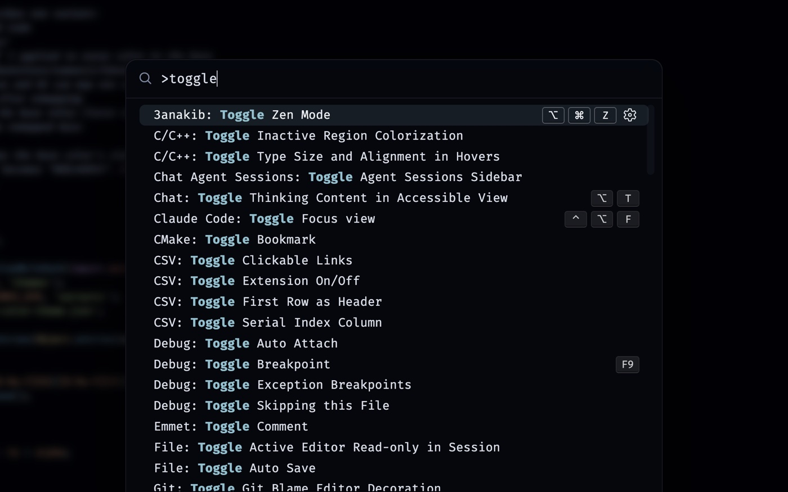

# [3anakib](https://marketplace.visualstudio.com/items?itemName=achrafelfadili.3anakib)

**The other dark theme..., but with a few tweaks.** A dark theme for every language out there, in two flavors, with an optional Zen Mode and a Spotlight-style command palette.

[](https://vscode.dev/theme/achrafelfadili.3anakib)
[](https://marketplace.visualstudio.com/items?itemName=achrafelfadili.3anakib)
[](https://marketplace.visualstudio.com/items?itemName=achrafelfadili.3anakib)
[](https://github.com/0xShady/3anakib-theme/stargazers)
[](https://github.com/0xShady/3anakib-theme/network/members)
[](https://github.com/0xShady/3anakib-theme)
[](https://github.com/0xShady/3anakib-theme/issues)
[](https://github.com/0xShady/3anakib-theme/blob/main/license.txt)
[](https://paypal.me/achrafelfadili?country.x=MA&locale.x=en_US)



## Contents

- [Installation](#installation)
- [Themes](#themes)
- [Zen Mode](#zen-mode)
- [Optional CSS Extras](#optional-css-extras)
- [Language Support](#language-support)
- [Development](#development)
- [Issues and Changelog](#issues-and-changelog)
- [Big Thanks](#big-thanks)

## Installation

Search for **3anakib** in the Extensions view, or open the command palette (`cmd/ctrl + shift + p`) and run:

```
ext install achrafelfadili.3anakib
```

Then pick a theme with `Preferences: Color Theme`. Requires VS Code 1.70 or newer.

## Themes

| Theme | Look |
| --- | --- |
| **3anakib theme** | The original: green accents on a deep purple-black background. |
| **3anakib darker** | Near-black blue backgrounds, Nord-inspired accents and brighter syntax colors. |



More of **3anakib theme**:





## Zen Mode

Run `3anakib: Toggle Zen Mode` or press `cmd+alt+z` (`ctrl+alt+z` on Windows/Linux).

It hides the minimap, breadcrumbs, folding, editor actions, back/forward arrows and the agent status pill, and keeps only the command center in the title bar. Run it again to restore your previous settings.

## Optional CSS Extras

> **Warning:** VS Code has no API for extensions to restyle its interface. These extras rely on the third-party [Custom CSS and JS Loader](https://marketplace.visualstudio.com/items?itemName=be5invis.vscode-custom-css) extension, which **patches VS Code's own files**. Afterwards VS Code shows *"Your Code installation appears to be corrupt"* and may mark itself *[Unsupported]*. This is expected and harmless, but it is your call. VS Code updates remove the patch, so re-apply it after updating.
>
> The themes and Zen Mode work without any of this.

Run `3anakib: Choose CSS Extras` and pick any of:

| Extra | What it does |
| --- | --- |
| **Spotlight command palette** | Centered, Raycast/Spotlight-style Quick Open and Command Palette with a blurred backdrop. Follows the active theme's colors. |
| **Monospace UI** | Explorer, tabs, status bar and menus use your terminal font, or your editor font if no terminal font is set. |
| **Quiet title & status bar** | Hides the Agents Window button, the notifications bell, and the Discord, Live Share, Live Server and Prettier status items. |

The command offers to install the loader if needed, then to apply and restart.

- **Undo:** `3anakib: Remove CSS Extras`
- **Remove the patch entirely:** `Disable Custom CSS and JS`



## Language Support

TypeScript / JavaScript · HTML / CSS / XML · Markdown · JSON / YAML · Python · Java · C / C++ · C# · Go · Ruby · PHP · Shell

## Development

```sh
npm run dev     # or F5 → "3anakib: Live Dev"
npm run build   # regenerate theme variants
```

`npm run dev` opens a dev window with its own profile in `.dev-profile/`, seeded from your settings, and reloads live on save:

| File | What happens on save |
| --- | --- |
| `themes/3anakib theme-color-theme.json` | Applied to the dev window. |
| `themes/variants/darker.json` | `3anakib darker` is rebuilt from the base theme with this color remap. Don't edit `3anakib darker-color-theme.json` directly. |
| `css/*.css` | The CSS extras are injected into the dev window. No loader or restart needed. |

Notes:

- Semantic token colors (e.g. `variable.readonly`) can stay stale after a live reload. Reopen the file to refresh them.
- Delete `.dev-profile/` to re-seed it from your current settings.
- With 3anakib also installed from the Marketplace, the dev window may start on the installed version's theme. Pick the theme again with `Preferences: Color Theme`.

## Issues and Changelog

Report issues on the [GitHub repository](https://github.com/0xShady/3anakib-theme/issues). See what changed in the [changelog](https://github.com/0xShady/3anakib-theme/blob/main/CHANGELOG.md).

## Big Thanks

The early 3anakib:

* [@yaiba](https://github.com/NotYaiba)
* [@boufal](https://github.com/saadennour)
* [@dopamine](https://github.com/0xDopamine)
* [@floki](https://github.com/floki61)
* [@joroh](https://github.com/0xJoroh)
* [@regular_nassim](https://github.com/nassimabb)
* [@l9irch](https://github.com/ELORCHI)
* [@jesus](https://github.com/myluda12)
